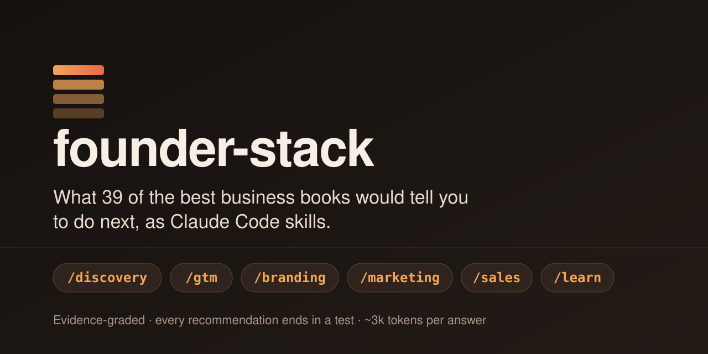

<p align="center">
  
</p>

<p align="center">
  <b>Claude Code skills for founders.</b> Customer discovery, go-to-market, branding, marketing and sales,<br>
  distilled from 39 of the best business books. Every recommendation ends in a test.
</p>

<p align="center">
  <a href="LICENSE"></a>
  
  
  
  
</p>

<p align="center">
  <a href="#install">Install</a> ·
  <a href="#see-it-work">See it work</a> ·
  <a href="#whats-inside">What's inside</a> ·
  <a href="#faq">FAQ</a>
</p>

---

## Your AI is guessing

Ask an AI how to position your product, price it or unstick a deal, and you get a confident plan.
It comes with a market size nobody sourced, personas nobody met, and advice blended from a hundred
blog posts. It reads well. You find out it was wrong months later.

The real answers exist. *Crossing the Chasm*, *Obviously Awesome*, *How Brands Grow*,
*$100M Offers*, *SPIN Selling*, *The JOLT Effect* and more contain them. But they're spread across
thousands of pages, and the authors often disagree with each other.

## founder-stack makes Claude answer like someone who has read them all

- **48 playbooks, each built around a founder problem.** Each one solves a single problem, such as
  "deals go dark after the demo", "nobody remembers us" or "our offer doesn't convert". It combines
  the strongest method from 2–5 books and credits every step to its author.
- **The experts' disagreements are written down.** Sharp or Neumeier? Challenger or SPIN? Hormozi
  or Godin? Every skill has a table that says which side wins in which situation.
- **Nothing is made up.** Claims about your business are labeled FACT (sourced), ASSUMPTION (graded
  E0–E4) or UNKNOWN. No invented numbers, no invented customers. Pricing counts as validated only
  when someone pays.
- **Every answer ends in a test.** You get the recommendation, the filled-in deliverable, the
  reasoning, the assumptions it rests on, and the cheapest way to check them this week.
- **About 3k tokens per answer.** Each skill loads only the one or two playbooks your question needs.
  Multi-agent deep mode runs only when you ask for it.

## Install

**As a Claude Code plugin** (recommended):

```text
/plugin install founder-stack --marketplace ajstars1/founder-stack
```

Or, on older versions: `/plugin marketplace add ajstars1/founder-stack`, then `/plugin install founder-stack@founder-stack`.

**As plain skills** in `~/.claude/skills` (no plugin system): see [`docs/INSTALL.md`](docs/INSTALL.md).

Then ask in plain words, or call a skill directly:

```text
/founder-stack  I have an idea for an app for X. Where do I start?
/gtm            How should we position against Notion?
/branding       Name our company.
/marketing      Our landing page converts at 0.4%. Fix the offer.
/sales          The deal went dark after a great demo.
/learn          Teach me sales, one lesson at a time.
```

(Installed as a plugin, the skills are namespaced: `/founder-stack:gtm`, `/founder-stack:sales`, … Pick one install method; plain skills with the same names shadow the plugin.)

## See it work

> **Founder:** *"We gave a great demo to the head of talent at a 400-person company. She loved it,
> said she'd loop in her VP, and it's been 3 weeks of silence. Two follow-ups, no reply."*

`/sales` routes this to its **stalled-deals** playbook (JOLT, Gap Selling, Voss, SPIN and Founding
Sales combined). It reads two files and answers:

- **Diagnosis.** "She loved it" was a polite deferral, not an advance. Nobody knows yet whether the
  status quo is winning (she never accepted change) or indecision is (she wants it but can't
  decide). The next message has to find out. [Rackham] [Dixon]
- **Recommendation.**
  - Send one "has something changed?" note that's easy to say no to. Don't send a third chaser. [Voss] [Keenan]
  - If the problem is indecision, recommend one option, cap how much more research she asks for,
    and lower the risk: a single-team 60-day start with a cancellation window.
  - Give her a one-page brief she can forward to the VP.
- **Assumptions logged.**
  - `A1` She has accepted that something must change. Test: her reply. Bar: she names a blocker in writing (E2).
  - `A3` A smaller start that's easy to cancel moves stuck buyers. Bar: a signed joint plan on 3 or more deals (E3).
- **Next action.** Send the note today. If there's no reply by day 10, mark the deal closed-lost
  and set a date to try again.

## What's inside

| Skill | What it does | Playbooks |
|---|---|---|
| **`/founder-stack`** | Router. Takes your situation, picks the right skill, keeps the Belief Ledger, chains skills from idea to scale | n/a |
| **`/gtm`** | Go-to-market strategy | positioning · category design · beachhead & chasm · launch strategy · pricing & packaging · product-led growth · marketplace cold start · platform design · growth model · GTM motion & scaling · moats · JTBD for GTM |
| **`/branding`** | Brand strategy | brand foundation · differentiation vs distinctiveness · distinctive assets · naming · messaging & BrandScript · archetypes · community · brand architecture · rebrand decision · brand audit |
| **`/marketing`** | Demand and growth | offer design · lead magnets · money model · copywriting & headlines · sticky messages · word of mouth · channel selection · growth experiments · activation & retention · ethical persuasion · audience & permission · reframing · founder posts & communities |
| **`/sales`** | Founder-led B2B sales | first customers · ICP & lists · first-ask design · cold outreach · discovery calls · Mom Test conversations · demo & pitch · objections · stalled deals · negotiation · investor pitch · pipeline · sales team |
| **Discovery** | Find a problem worth solving | `/where-to-play` · `/problem-discovery` · `/customer-discovery` · `/jtbd` · `/value-proposition-canvas` · `/business-model-canvas` · `/experiments` · `/secondary-research` · `/facts-assumptions-unknowns` · `/startup-scorecard` |
| **`/outreach-sprint`** | Run the push | daily math, warm rings, agent target research, approval-gated sends, follow-up calendar, reply scripts, scoreboard, retro into `discovery/FIELD-NOTES.md` |
| **`/learn`** | Tutor | short lessons applied to your venture, with spaced-repetition quizzes |

### How the pieces connect

```
 idea ─► /where-to-play ─► /problem-discovery ─► /customer-discovery ─► /jtbd ─► /value-proposition-canvas
                                                                                   │
        ┌──────────────── every recommendation becomes a ledger assumption ◄───────┤
        ▼                                                                          ▼
 discovery/LEDGER.md ◄─ /experiments ◄─ /gtm ─► /branding ─► /marketing ─► /sales ─► first revenue
```

All skills share one record per venture: `discovery/LEDGER.md` and `00-CONTEXT.md`. Domain skills
read it first and write their untested advice into it, and experiments move the evidence grades.
Advice and evidence run on the same loop.

## Sources

The playbooks synthesize 39 books, including *Obviously Awesome* (Dunford), *Crossing the Chasm*
(Moore), *7 Powers* (Helmer), *The Cold Start Problem* (Chen), *Play Bigger*, *Product-Led Growth*
(Bush), *How Brands Grow* (Sharp), *Building a StoryBrand* (Miller), *Zag* (Neumeier),
*$100M Offers* (Hormozi), *Breakthrough Advertising* (Schwartz), *Influence* (Cialdini), *Traction*
(Weinberg), *Hacking Growth* (Ellis), *Hooked* (Eyal), *SPIN Selling* (Rackham),
*The Challenger Sale* and *The JOLT Effect* (Dixon), *Never Split the Difference* (Voss),
*Founding Sales* (Kazanjy) and *The Mom Test* (Fitzpatrick). Full list:
[`docs/SOURCES.md`](docs/SOURCES.md).

**How they were distilled:**
- A study card was written for each book from its full text. Every quote on every card was checked
  word for word against the book.
- The cards were then rewritten as playbooks in our own words.
- A checker confirms that no 10-word run in this repo matches any book.

No book text is reproduced. Read the originals; they reward it.

The discovery skills implement the published methods of Steve Blank & Bob Dorf, Osterwalder &
Pigneur, David J. Bland, Gruber & Tal, Giff Constable, Christensen & Ulwick, Dave Gray and Eric Ries.
Their sequencing is inspired by the incubation curriculum of the Gopalakrishnan-Deshpande Centre,
IIT Madras.

## FAQ

**What are Claude Code skills?**
Folders containing a `SKILL.md` that Claude loads when your request matches. founder-stack is 16 of
them, installable as a plugin or as plain skill folders.

**How is this different from asking Claude directly?**
Claude on its own improvises from general knowledge. founder-stack gives it a specific method for
each problem, reconciled across the best books. It also makes Claude separate facts from guesses and
end every answer with a test you can run.

**Is this only for software startups?**
The playbooks lean B2B and SaaS, because the books do. Branding, marketing, offers and customer
discovery apply to any business. Where the books are thin (services, India and emerging markets,
AI-era distribution, SEO), the skills say so and research with dated, cited sources instead of
guessing.

**Does it browse the web?**
Only for facts books can't know: competitors, current prices and channel costs, trademark and domain
availability, platform rules and market data. Every one is cited with a URL and date.

**How much does it cost in tokens?**
Skill descriptions are one or two lines each. A typical answer reads one `SKILL.md` and one or two
playbooks, about 3–4k tokens. Deep mode (parallel agents plus a verifier) is opt-in.

**I used startup-coach. What changes?**
founder-stack is its successor. `install.sh` replaces the old skills and retires `/startup-coach`,
and your `discovery/LEDGER.md` keeps working.

**Can I add my own books?**
Contributions follow [`docs/SKILL-SPEC.md`](docs/SKILL-SPEC.md). Write in your own words and credit
every method. If you run a `business-books` MCP server (a local full-text index of books you own),
the skills can quote originals and `/learn` can deep-read chapters. The server isn't part of this
repo.

## What this plugin runs and accesses

- **No code runs when you install it.** The plugin is Markdown skill files only: no hooks, no MCP
  servers, no scripts, no network calls of its own. `install.sh` is an optional local copy script for
  the plain-skills route, and you run it yourself.
- **Files:** skills read and write only `discovery/LEDGER.md`, `discovery/00-CONTEXT.md` and their
  debrief folders in your project. `/learn` keeps your progress in `~/.founder-stack/progress.md`.
- **Your data:** the router may *ask Claude to read* artifacts you point it to (your repo, analytics
  exports, sales notes) to check claims against the record. Nothing is read without you asking, and
  nothing is sent anywhere by the plugin. Full details: [Privacy](PRIVACY.md).
- **Web:** skills tell Claude to use its built-in web search only for current public facts
  (competitors, prices, trademark or domain availability, platform rules), always cited.

## Docs

- [`docs/ARCHITECTURE.md`](docs/ARCHITECTURE.md): the ledger, evidence grades, domain-skill design, the token economy
- [`docs/SKILL-SPEC.md`](docs/SKILL-SPEC.md): the contract every domain skill follows
- [`docs/PHILOSOPHY.md`](docs/PHILOSOPHY.md): why zero-hallucination coaching
- [`CONTRIBUTING.md`](CONTRIBUTING.md) · [`CHANGELOG.md`](CHANGELOG.md) · [Privacy](PRIVACY.md)

---

<p align="center">
  <b>Stop guessing. Install founder-stack and ask your hardest business question.</b><br>
  <code>/plugin install founder-stack --marketplace ajstars1/founder-stack</code><br><br>
  MIT licensed · built by <a href="https://github.com/ajstars1">Ayush Jamwal</a> · if it helps, a ⭐ helps other founders find it
</p>
